# A
# SOFTWARE REQUIREMENT SPECIFICATION
## ON
# MOVIE TICKET BOOKING MANAGEMENT SYSTEM
### UNDER
### MINI PROJECT LAB (NON-SYLLABUS PROJECT)

  

 

| **Submitted To:** | **Submitted By:** |
| :--- | :--- |
| **Dr. Shikha Gautam** | **Mahika Khanna (PIET25CS089)** |
| **Assistant Professor** | **B.Tech CSE, 2nd Year, 3rd Sem** |

   
  <strong>DEPARTMENT OF COMPUTER ENGINEERING</strong> 
  <strong>POORNIMA INSTITUTE OF ENGINEERING & TECHNOLOGY, JAIPUR</strong> 
  <strong>Academic Year (2026-27)</strong>

---

### **Chapter 1: Introduction of Project**

### 1.1 Objective of Project
The main purpose of this project is to develop a simple desktop application for managing the movie ticket booking work of a cinema hall or theater. In many local theaters the details of movies, the show schedule, customer reservations and ticket collections are still written in registers or kept in Excel sheets. This takes a lot of time, mistakes can happen easily, and finding the record of a single booking is difficult.

The Movie Ticket Booking Management System solves this problem. All the data is stored in a MySQL database and the user works on it through simple Java Swing screens. Using this project the user can:
* login securely with a username and password;
* add, update, delete and search movie records (movie name, genre, duration, language and ticket price);
* add, update, delete and search customer records (name, mobile and email);
* book movie tickets for a customer, select show date, show time and seat number, and the total amount is calculated automatically;
* prevent duplicate seat bookings for the same show;
* view all the records in a table, cancel a booking, and change his/her own password.

### 1.2 Types of Users
The system has two types of users. The role of every user is stored in the database and the screens work according to this role.

| User Type | Who uses it | What the user can do |
| :--- | :--- | :--- |
| **Admin** | Theater management / staff in charge | Full access. Can add, update, delete, view and search records (movies, customers and bookings), cancel bookings, view total revenue, and change the password. |
| **User** | Booking counter clerk / front desk staff | Can only view movies, search records, book tickets for customers, view all records and change his/her own password. The Add, Update and Delete buttons for movies are disabled for this user. |

1

---

### **Chapter 2: Requirement Analysis**

### 2.1 Functional Requirement
The following functions are provided by the system.

| No. | Function | Description |
| :---: | :--- | :--- |
| 1 | **Login System** | The user enters username and password. They are checked in the users table of MySQL and the user enters as Admin or User according to the role. |
| 2 | **Dashboard** | Shows the total number of movies, customers, bookings and total revenue, and has buttons to open every module. |
| 3 | **Add Record** | New movie, customer and booking records are entered in a Swing form and saved in the database after validation. |
| 4 | **Update Record** | The user selects a record from the table, changes the details and saves it. |
| 5 | **Delete Record** | The selected record is deleted from the database only after the user confirms it. |
| 6 | **View All Records (JTable)** | All records are shown in a JTable. The table can be scrolled and sorted by clicking on the column heading. |
| 7 | **Search Record** | Movies are searched by name or genre, customers by name or mobile, and bookings by customer name or movie. |
| 8 | **MySQL Database Connectivity (JDBC)** | The Java program is connected with the MySQL database using JDBC to perform all the CRUD operations. |
| 9 | **Form Validation** | Checks that all fields are filled, phone number has 10 digits, duration and ticket price are numbers, date and show time are selected, and duplicate seat booking for the same show is not entered. |
| 10 | **Menu Bar and Toolbar** | The dashboard has a menu bar (File, Manage, Help) and a toolbar. The record screens have a toolbar with Add, Update, Delete, Search, Clear and Close buttons. |
| 11 | **Logout** | Closes all the open screens and returns to the login screen without closing the application. |
| 12 | **Password Change** | The user enters the old password and the new password twice. The old password is checked before the new one is saved. |

2

---

### 2.2 Technology Used

| Component | Technology |
| :--- | :--- |
| **Programming Language** | Java (JDK) |
| **GUI** | Java Swing (JFrame, JPanel, JLabel, JTextField, JPasswordField, JComboBox, JButton, JTable, JMenuBar, JToolBar, JOptionPane) |
| **Database** | MySQL |
| **Database Tool** | MySQL Workbench |
| **Connectivity** | JDBC with MySQL Connector/J (mysql-connector-j-8.4.0.jar) |
| **IDE** | IntelliJ IDEA |
| **Operating System** | Windows |

### 2.3 Graphical User Interface
The project has the following screens. All of them are made using Java Swing.
* **Login Page:** has username and password fields with Login and Exit buttons. Wrong or empty input shows a message.
* **Dashboard:** shows the welcome message with the role of the user, four boxes with the total number of movies, customers, bookings and revenue, buttons to open the modules, and a menu bar and toolbar for quick navigation.
* **Movie Page:** form with Movie ID, Name, Genre, Duration, Language and Price, a search box and a JTable showing all movies.
* **Customer Page:** form with Customer ID, Name, Mobile and Email, a search box and a JTable showing all customers.
* **Ticket Booking Page:** form with Customer ID, Movie ID, Number of Tickets, Show Date, Show Time and Seat Number. The total amount is calculated automatically by the program. The JTable shows all booking records with customer name, movie name, seat, and status.
* **Change Password Page:** old password, new password and confirm password fields.

When a row of the table is clicked, its data comes in the form so that it can be updated or deleted.

3

---

### **Chapter 3: Design**

### 3.1 Use Case Diagram

  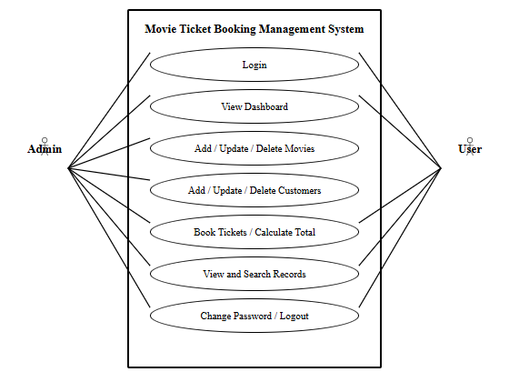
   
  <strong>Figure 3.1: Use Case Diagram of Movie Ticket Booking Management System</strong>

 

There are two actors in the system, Admin and User. Both of them have to login first. The Admin can manage the records of movies, customers and bookings (add, update and delete), view and search them, and also use the dashboard, change password and logout. The User can only open the dashboard, view and search the records, book tickets, change his/her password and logout.

### 3.2 Data Base Tables
The database is named **movie_ticket_db** and has four tables. The tables are shown below.

#### Table 3.1: users (stores the login details)
| Column | Data Type | Description |
| :--- | :--- | :--- |
| user_id | INT, AUTO_INCREMENT | Primary key |
| username | VARCHAR(30) | Unique, not null |
| password | VARCHAR(30) | Not null |
| role | VARCHAR(10) | Admin or User |

#### Table 3.2: movies
| Column | Data Type | Description |
| :--- | :--- | :--- |
| movie_id | INT, AUTO_INCREMENT | Primary key |
| movie_name | VARCHAR(50) | Not null |
| genre | VARCHAR(30) | Not null |
| duration | INT | Not null |
| language | VARCHAR(20) | Not null |
| ticket_price | DOUBLE | Not null |

4

---

#### Table 3.3: customers
| Column | Data Type | Description |
| :--- | :--- | :--- |
| customer_id | INT, AUTO_INCREMENT | Primary key |
| customer_name | VARCHAR(50) | Not null |
| mobile | VARCHAR(15) | Not null |
| email | VARCHAR(50) | Not null |

#### Table 3.4: bookings
| Column | Data Type | Description |
| :--- | :--- | :--- |
| booking_id | INT, AUTO_INCREMENT | Primary key |
| customer_id | INT | Foreign key of customers(customer_id) |
| movie_id | INT | Foreign key of movies(movie_id) |
| number_of_tickets | INT | Not null |
| ticket_price | DOUBLE | Not null |
| total_amount | DOUBLE | Calculated by the program (tickets * price) |
| booking_date | DATE | Not null |
| show_time | VARCHAR(20) | Not null |
| seat_number | VARCHAR(20) | Not null |
| booking_status | VARCHAR(15) | Confirmed or Cancelled |

 

**Relationship:** One customer can have many bookings and one movie can also have many bookings. So the bookings table is connected with the customers and movies tables using the foreign keys customer_id and movie_id (ON DELETE RESTRICT, ON UPDATE CASCADE). The combination (movie_id, booking_date, show_time, seat_number) is checked by the application so that the same seat cannot be booked twice for the same movie show.

5

---

### **Chapter 4: Conclusion**

In this project a Movie Ticket Booking Management System was developed using Java Swing, JDBC and MySQL. The project has a login system with two roles, a dashboard, and separate screens for movies, customers and bookings. All the common modules given for the minor project were completed: Add, Update, Delete, View all records in JTable, Search, form validation, menu bar and toolbar, logout and password change.

Through this project I learned how to design GUI screens with Swing, how to create tables in MySQL, how to connect a Java program with a database using JDBC and PreparedStatement, and how to handle wrong input and exceptions so that the program does not stop suddenly.

The project works as a small but complete application and the records are now stored safely in a database instead of registers. In future the project can be improved by:
* storing the passwords in encrypted form;
* printing the ticket receipt / confirmation slip for the customer;
* adding a visual seat layout map showing available and booked seats;
* adding an online payment gateway (UPI/card) module.

6

---

### **Chapter 5: Snapshots of Your Project**

  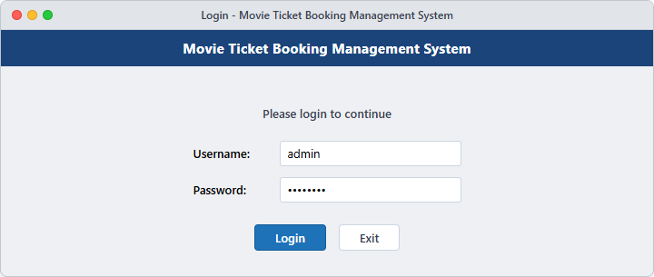
   
  <strong>Figure 5.1: Login Page</strong>

  

  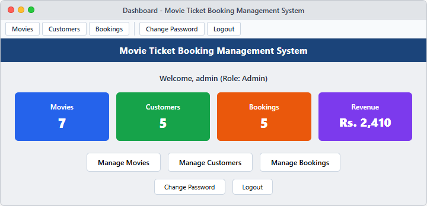
   
  <strong>Figure 5.2: Home / Dashboard</strong>

7

---

  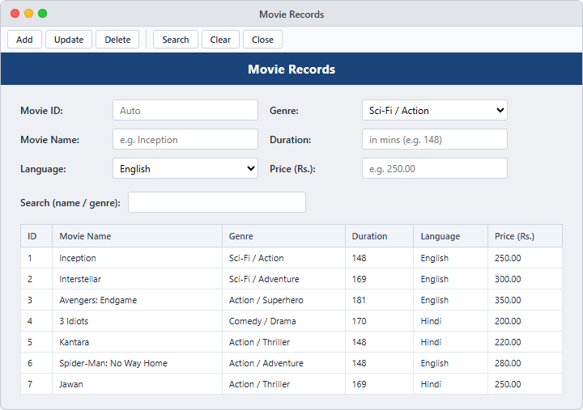
   
  <strong>Figure 5.3: Movie Page showing all records in JTable</strong>

  

  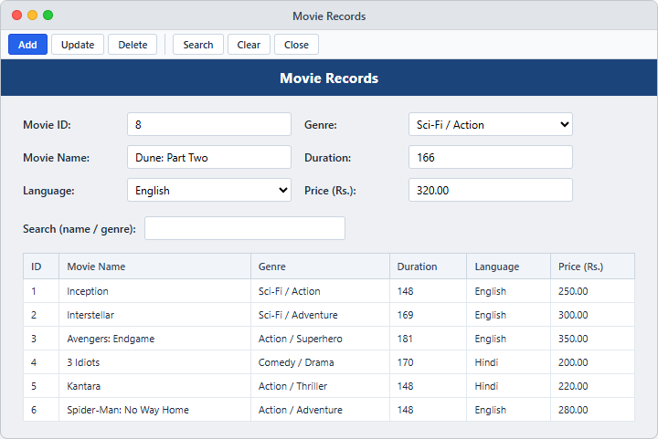
   
  <strong>Figure 5.4: Add Movie (Registration) Page</strong>

8

---

  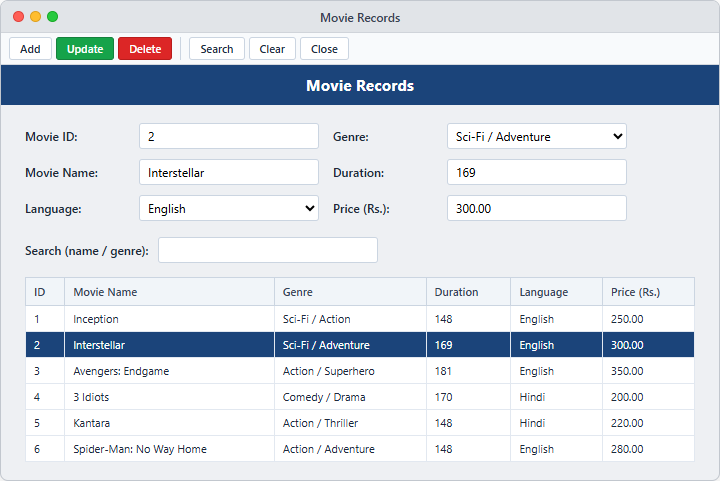
   
  <strong>Figure 5.5: Update / Delete Movie Page (record selected from table)</strong>

  

  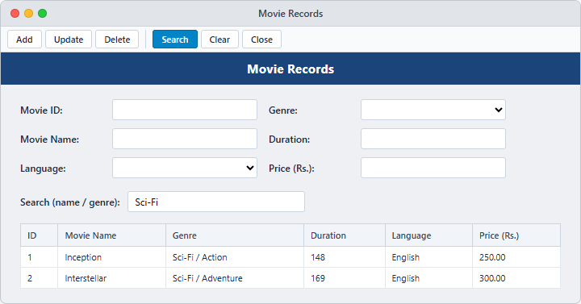
   
  <strong>Figure 5.6: Search Page (searching movie by name)</strong>

9

---

  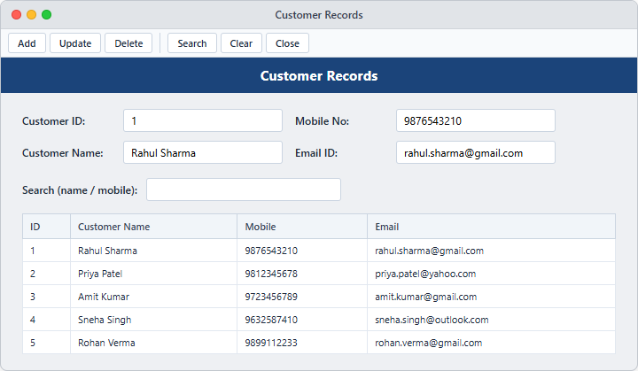
   
  <strong>Figure 5.7: Customer Records Page</strong>

  

  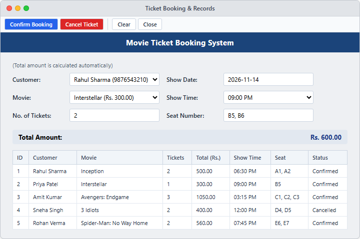
   
  <strong>Figure 5.8: Ticket Booking Page</strong>

10

---

  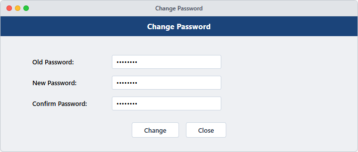
   
  <strong>Figure 5.9: Change Password Page</strong>

  

  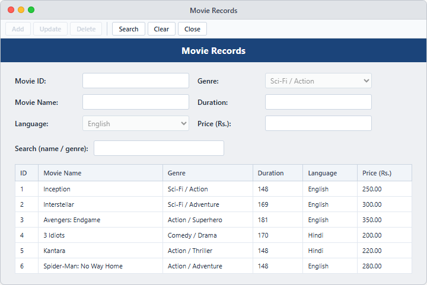
   
  <strong>Figure 5.10: Movie Page for the User role (Add, Update and Delete buttons disabled)</strong>

11

