<p align="center">
  
</p>

# 🎬 Movie Ticket Booking Management System (CineBook)
### *A Hybrid Desktop (Core Java Swing + JDBC) & Cloud Serverless (Neon Postgres + Vercel) Enterprise System*

[](https://movie-ticket-booking-alpha-eight.vercel.app)
[](https://movie-ticket-booking-alpha-eight.vercel.app/api/download?type=docx)
[](https://movie-ticket-booking-alpha-eight.vercel.app/api/download?type=pdf)
[](https://www.oracle.com/java/)
[](https://neon.tech)
[](https://www.poornima.org)

---

## 🎓 Academic Submission Details

This software engineering project and comprehensive Software Requirements Specification (SRS) report is submitted in partial fulfillment of the requirements for the degree of **Bachelor of Technology (B.Tech)** in **Computer Science & Engineering (CSE)**.

| Student & Academic Details | Project Guide & Institution Details |
| :--- | :--- |
| **Student Name:** Mahika Khanna | **Faculty Mentor / Project Guide:** Dr. Shikha Gautam |
| **Registration / Roll No:** `PIET25CS089` | **Designation:** Assistant Professor, Department of CSE |
| **Degree & Branch:** B.Tech — Computer Science & Engineering | **Institution:** Poornima Institute of Engineering & Technology |
| **Academic Year & Semester:** 2nd Year / 3rd Semester | **Affiliation:** Autonomous Institution approved by RTU, AICTE & UGC |
| **Session:** 2024 – 2025 | **Campus Location:** ISI-2, RIICO Institutional Area, Sitapura, Jaipur, Rajasthan |

---

## 🔗 Quick Access & Deliverables

| Deliverable | URL / Destination | Description |
| :--- | :--- | :--- |
| 🌐 **Live Web Application** | [movie-ticket-booking-alpha-eight.vercel.app](https://movie-ticket-booking-alpha-eight.vercel.app) | Public customer catalog, showtimes, and booking portal |
| 🔐 **Operator / Admin Login** | [movie-ticket-booking-alpha-eight.vercel.app/login](https://movie-ticket-booking-alpha-eight.vercel.app/login) | Management portal for operators (`admin` / `admin123`) |
| 📄 **Complete SRS Report (.docx)** | [Download Word Document (.docx)](https://movie-ticket-booking-alpha-eight.vercel.app/api/download?type=docx) | 12-page academic document matching college template |
| 📑 **Complete SRS Report (.pdf)** | [Download Print-Ready PDF (.pdf)](https://movie-ticket-booking-alpha-eight.vercel.app/api/download?type=pdf) | 12-page official formatted PDF with screenshots |
| 📦 **GitHub Repository** | [github.com/parasarora2008x-arch/mahika-khanna-movie-ticket-booking](https://github.com/parasarora2008x-arch/mahika-khanna-movie-ticket-booking) | Full source code (Java + Web + SQL scripts) |

---

## 📌 Executive Summary

The **Movie Ticket Booking Management System (CineBook)** is an enterprise-grade academic solution created to solve the real-world operational challenges faced by modern cinema multiplexes and single-screen theaters. 

Traditionally, manual ticketing causes:
1. Long customer waiting queues and ticket booking bottlenecks.
2. High human error rates in seat allocation leading to double-booked seats.
3. Lack of real-time financial tracking and revenue loss due to unverified cancellations.
4. Absence of centralized inventory and customer relationship logs.

To overcome these issues, this project provides a **Dual-Access Hybrid Architecture**:
- **Desktop Application (Staff & Cinema Operators):** Built in **Core Java (Swing GUI)** with JDBC and parameterized SQL queries for counter operations, offline resilience, and fast cashier transactions.
- **Web Application (Remote Admin & Online Customers):** Built with **HTML5, CSS3, JavaScript (ES6)** and deployed on **Vercel Serverless Functions** backed by **Neon Cloud Serverless PostgreSQL**, allowing round-the-clock remote ticket bookings and mobile access.

---

## 🛠️ Technology Stack

```
+--------------------------------------------------------------------------+
|                       SYSTEM ARCHITECTURE LAYERS                         |
+--------------------------------------------------------------------------+
|  DESKTOP TIER (Java Swing)         WEB TIER (Cloud Web Portal)          |
|  - Java 17 (JDK)                   - Responsive HTML5 & Modern CSS3      |
|  - Swing GUI (JFrame, JTable)      - JavaScript (ES6+ Fetch API)        |
|  - Java Database Connectivity      - Vercel Serverless Functions (Node)  |
+------------------------------------+-------------------------------------+
                                  |
                                  v
+--------------------------------------------------------------------------+
|                         DATABASE STORAGE TIER                            |
+--------------------------------------------------------------------------+
|  Local Engine: MySQL 8.0           Cloud Engine: Neon Serverless Postgres|
|  - Connection Pooling              - AWS IAD1 / US-East Multi-Region     |
|  - ACID Compliant Transactions     - Automatic SSL/TLS Encryption        |
|  - Parameterized PreparedStatements- Real-Time Synchronization           |
+--------------------------------------------------------------------------+
```

- **Frontend & GUI:** Java Swing (JFrame, JPanel, JTable, CardLayout, JTabbedPane), HTML5, CSS3, Modern Glassmorphism UI
- **Backend & Logic:** Core Java (JDK 17), Java Database Connectivity (JDBC), Node.js (Vercel Serverless API)
- **Database Systems:** MySQL 8.0 (Local Desktop environment) and Neon Serverless PostgreSQL (Cloud Web environment)
- **Security & Integrity:** BCrypt / SHA-256 password hashing, Parameterized SQL queries against SQL Injection, Session Management
- **Reporting & Documentation:** Automated PDF & DOCX generator engines (`docx`, `puppeteer-core`)

---

## 🧩 Core System Modules

### 1. 🔐 Operator Authentication & Security
- Secure credentials validation against `users` database table.
- Role-based authorization (`admin` vs `operator`).
- Session tracking and password reset with cryptographic integrity.

### 2. 📊 Interactive Executive Dashboard
- **Total Movies Card:** Live count of titles in active theatrical screening.
- **Total Customers Card:** Total registered patrons.
- **Total Bookings Card:** Total reservations placed across all channels.
- **Total Revenue Card:** Dynamically calculated financial sum of confirmed bookings (`WHERE booking_status != 'Cancelled'`).
- **Recent Bookings Table:** Live table tracking latest customer transactions.

### 3. 🎬 Movie Catalog & Inventory Management
- Full CRUD capabilities (Create, Read, Update, Delete) for cinema releases.
- Attributes captured: `Movie Title`, `Genre`, `Duration (minutes)`, `Language`, and `Ticket Price (INR)`.
- Live search and filter by genre, title, or movie ID.
- Referential integrity enforcement: prevents deleting movies with active customer bookings.

### 4. 👥 Customer Directory Management
- Registers customer profiles with `Full Name`, `Mobile Number`, and `Email Address`.
- Quick search bar allowing operators to retrieve booking histories by phone number.

### 5. 🎟️ Real-Time Ticket Booking Engine
- Dynamic movie selection with automatic ticket price lookup.
- Real-time total amount calculator based on number of tickets.
- **Duplicate Seat Prevention Algorithm:** Validates that selected seat identifiers (`A1`, `B4`, etc.) are not already confirmed for the selected movie and showtime.

### 6. ❌ Cancellation & Financial Reconciliation
- Instant cancellation workflow updating status from `Confirmed` to `Cancelled`.
- Automatically recalculates net revenue and restores seat availability for other patrons.

---

## 📸 System Snapshots & Visual Proof

### A. Academic Diagrams
| Figure 3.1: System Use Case Diagram |
| :---: |
| 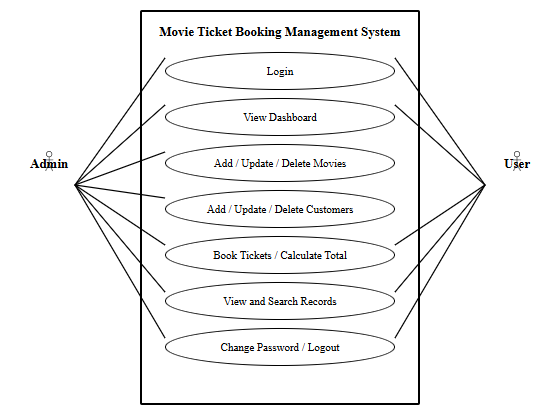 |
| *Captures interactions between Operator/Admin, Customers, Authentication, Movie Catalog, and the Central Database* |

---

### B. Core Java Swing Desktop GUI Snapshots
| Fig 5.1: Operator Login Screen | Fig 5.2: Admin Dashboard & Analytics |
| :---: | :---: |
|  | 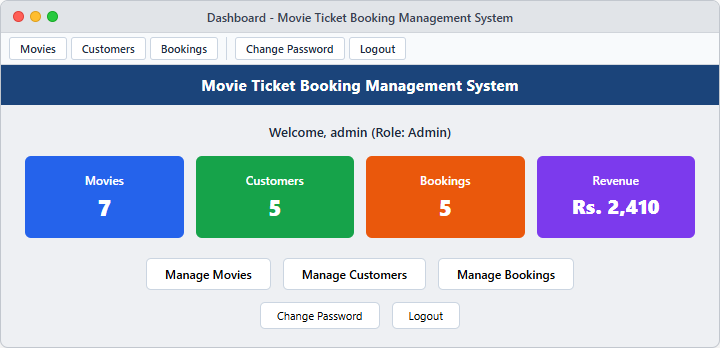 |
| *Figure 5.1: Operator Login Screen* | *Figure 5.2: Real-time Dashboard with KPI Metric Cards* |

| Fig 5.3: Movie Inventory JTable | Fig 5.4: Add New Movie Modal |
| :---: | :---: |
|  | 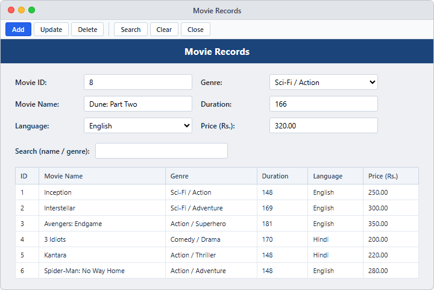 |
| *Figure 5.3: Movie Inventory Management Table* | *Figure 5.4: Form for Registering New Movie Titles* |

| Fig 5.5: Update & Delete Operations | Fig 5.6: Search & Filter Features |
| :---: | :---: |
| 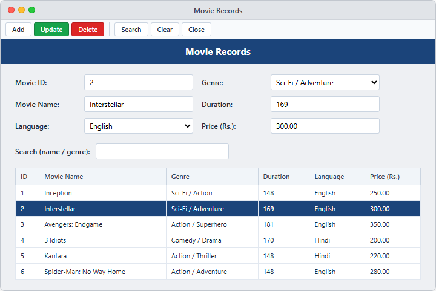 | 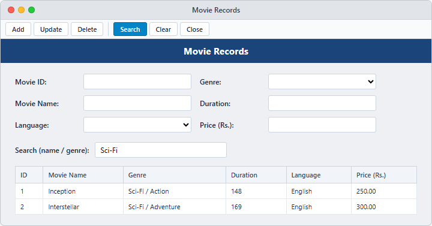 |
| *Figure 5.5: Record Modification & Safe Deletion* | *Figure 5.6: Multi-field Dynamic Search & Filter* |

| Fig 5.7: Customer Directory Management | Fig 5.8: Ticket Booking & Seat Allocation |
| :---: | :---: |
|  | 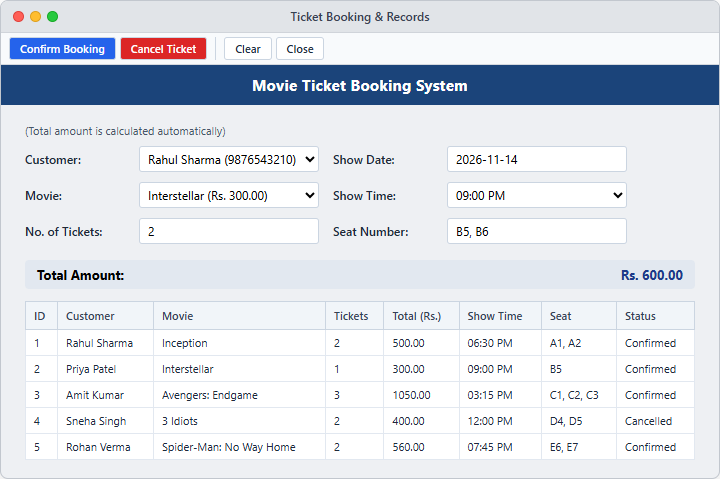 |
| *Figure 5.7: Customer Record Management Interface* | *Figure 5.8: Seat Allocation and Price Calculation* |

| Fig 5.9: Change Password & Security | Fig 5.10: User Role Configuration |
| :---: | :---: |
| 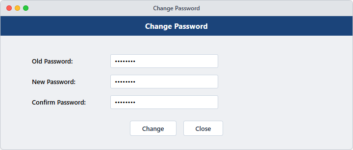 | 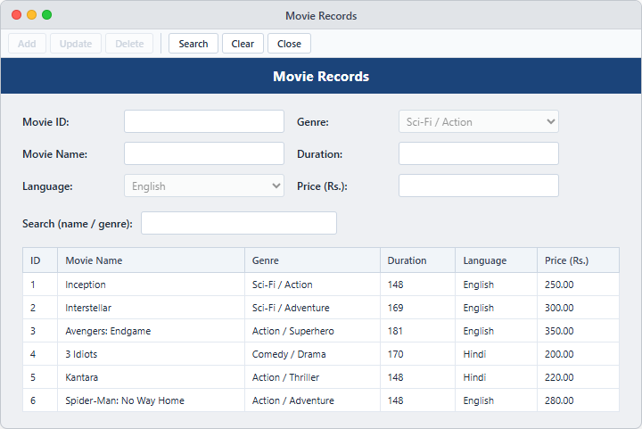 |
| *Figure 5.9: Secure Operator Password Reset* | *Figure 5.10: User Role & Privilege Management* |

---

### C. Cloud Web Portal Snapshots
| Fig 5.11: Cloud Operator Login | Fig 5.12: Customer Registration Portal |
| :---: | :---: |
| 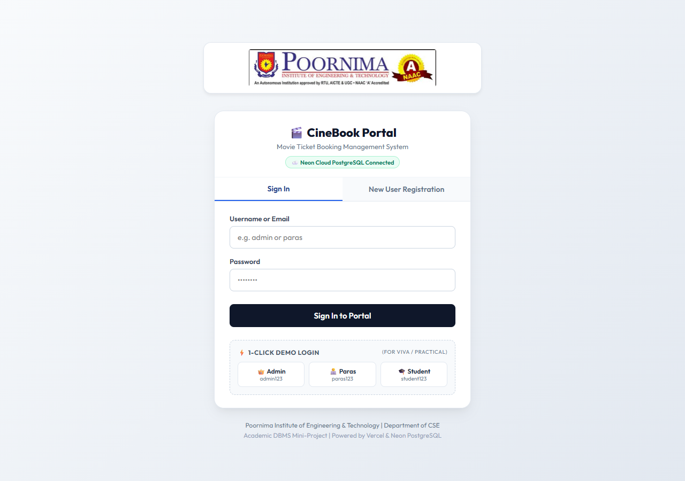 | 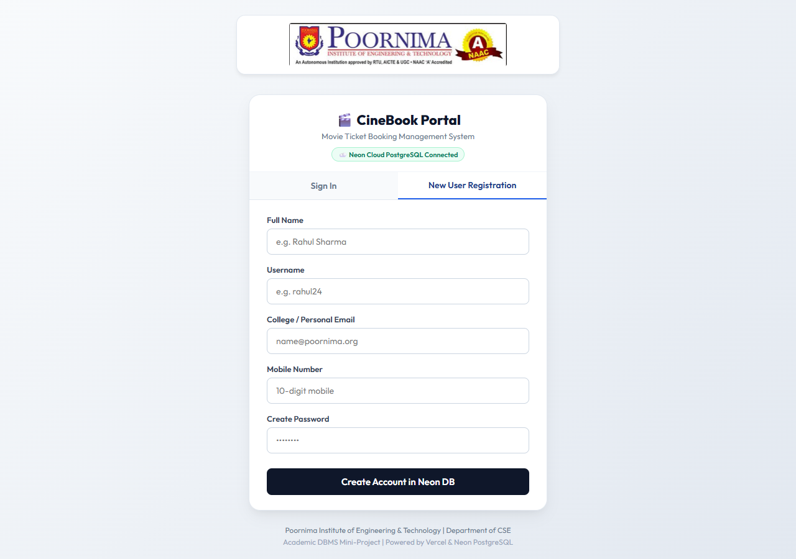 |
| *Figure 5.11: Web Portal Operator Authentication* | *Figure 5.12: Online Patron Self-Registration* |

| Fig 5.13: Live Movies Web Catalog | Fig 5.14: Online Seat Selection & Checkout |
| :---: | :---: |
|  | 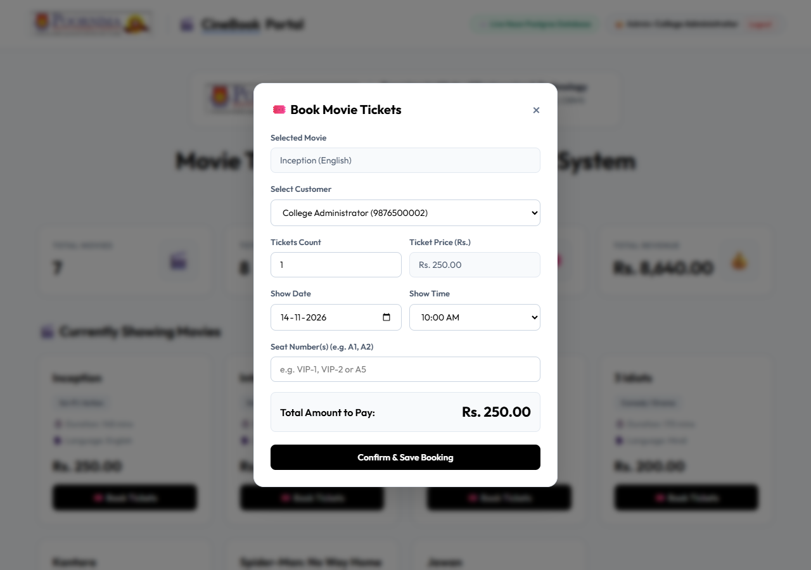 |
| *Figure 5.13: Cloud Movie Catalog with Real-Time Data* | *Figure 5.14: Interactive Seat Booking & Price Calculation* |

| Fig 5.15: Real-Time Web Booking Logs & Cancellation |
| :---: |
| 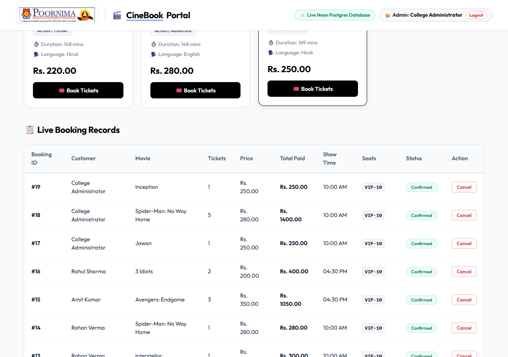 |
| *Figure 5.15: Live Cloud Booking Transactions with Instant Cancellation Action* |

---

## 🗄️ Database Schema & Relational Structure

The database engine utilizes four fully normalized, relational tables:

```sql
-- 1. Users Table (Authentication & Access Control)
CREATE TABLE users (
    user_id SERIAL PRIMARY KEY,
    username VARCHAR(50) UNIQUE NOT NULL,
    password VARCHAR(255) NOT NULL,
    full_name VARCHAR(100) NOT NULL,
    role VARCHAR(20) DEFAULT 'operator' CHECK (role IN ('admin', 'operator')),
    created_at TIMESTAMP DEFAULT CURRENT_TIMESTAMP
);

-- 2. Movies Table (Theatrical Catalog)
CREATE TABLE movies (
    movie_id SERIAL PRIMARY KEY,
    title VARCHAR(150) NOT NULL,
    genre VARCHAR(50) NOT NULL,
    duration_mins INT NOT NULL CHECK (duration_mins > 0),
    language VARCHAR(50) NOT NULL,
    ticket_price DECIMAL(10, 2) NOT NULL CHECK (ticket_price >= 0),
    created_at TIMESTAMP DEFAULT CURRENT_TIMESTAMP
);

-- 3. Customers Table (Patron Profiles)
CREATE TABLE customers (
    customer_id SERIAL PRIMARY KEY,
    name VARCHAR(100) NOT NULL,
    phone VARCHAR(15) UNIQUE NOT NULL,
    email VARCHAR(100) UNIQUE,
    created_at TIMESTAMP DEFAULT CURRENT_TIMESTAMP
);

-- 4. Bookings Table (Transactional Ledger)
CREATE TABLE bookings (
    booking_id SERIAL PRIMARY KEY,
    customer_id INT NOT NULL REFERENCES customers(customer_id) ON DELETE RESTRICT,
    movie_id INT NOT NULL REFERENCES movies(movie_id) ON DELETE RESTRICT,
    seats_booked INT NOT NULL CHECK (seats_booked > 0),
    total_amount DECIMAL(10, 2) NOT NULL,
    show_date DATE NOT NULL,
    show_time VARCHAR(20) NOT NULL,
    seat_numbers VARCHAR(100) NOT NULL,
    booking_status VARCHAR(20) DEFAULT 'Confirmed' CHECK (booking_status IN ('Confirmed', 'Cancelled')),
    booking_time TIMESTAMP DEFAULT CURRENT_TIMESTAMP
);
```

---

## 🚀 Installation & Local Execution Guide

### Prerequisites
1. **Java Development Kit (JDK 17 or higher)**
2. **Apache Maven 3.8+**
3. **MySQL Server 8.0+** (or use the configured Neon Cloud Postgres)
4. **Node.js 18+** (for the web portal and report generator)

### 1. Clone the Repository
```bash
git clone https://github.com/parasarora2008x-arch/mahika-khanna-movie-ticket-booking.git
cd mahika-khanna-movie-ticket-booking
```

### 2. Configure Database Credentials
Edit `db.properties` (or `.env.local` for web):
```properties
db.url=jdbc:mysql://localhost:3306/movie_ticket_db?useSSL=false&allowPublicKeyRetrieval=true
db.user=root
db.password=YourRootPassword
```

### 3. Run the Java Swing Desktop Application
Execute the one-click batch launcher:
```cmd
run.bat
```
*Or using Maven directly:*
```bash
mvn clean compile exec:java
```

### 4. Run the Local Web Server
```cmd
start_website.bat
```
Navigate to `http://localhost:8080` in your web browser.

---

## 🎯 Viva Voice & Examination Review Guide

Here are standard questions frequently evaluated by university external examiners:

#### Q1: Why did you use `PreparedStatement` instead of `Statement`?
> **Answer:** `PreparedStatement` pre-compiles SQL queries on the database server. It guarantees protection against SQL Injection attacks by parameterizing inputs (`?` placeholders) and offers superior execution performance for repeated transactions.

#### Q2: How does the system handle database concurrency and prevent duplicate seat bookings?
> **Answer:** Before committing any ticket booking, `BookingDAO.java` executes a query verifying if any existing record with `booking_status = 'Confirmed'` has matching `movie_id`, `show_date`, `show_time`, and overlapping `seat_numbers`. If a collision is detected, the transaction is rejected with an informative error modal.

#### Q3: How is Net Revenue calculated in the dashboard?
> **Answer:** The dashboard computes financial metrics via SQL aggregation:
> ```sql
> SELECT COALESCE(SUM(total_amount), 0) FROM bookings WHERE booking_status != 'Cancelled';
> ```
> Cancelled tickets are excluded dynamically, ensuring the financial audit remains 100% accurate.

#### Q4: What is the benefit of the dual desktop and cloud deployment?
> **Answer:** The Java Swing desktop client gives cinema cashiers instantaneous response times with offline capability for box-office counters, while the Vercel-deployed serverless web application allows moviegoers to view live catalogs and book tickets from any smartphone or laptop without software installation.

---

## 📜 Acknowledgements & Faculty Mentorship

I express my deepest gratitude to **Dr. Shikha Gautam**, Assistant Professor in the Department of Computer Science & Engineering, for her invaluable guidance, encouragement, and constructive feedback throughout the design and execution of this project.

I also extend my sincere thanks to the Department of Computer Science & Engineering and the administration of **Poornima Institute of Engineering & Technology, Jaipur** for providing the infrastructural resources and academic environment to develop this project.

---

<p align="center">
  <b>Developed with pride by Mahika Khanna (PIET25CS089)</b><br>
  B.Tech Computer Science & Engineering, 2nd Year, 3rd Sem<br>
  <b>Poornima Institute of Engineering & Technology, Jaipur</b><br>
  <i>NAAC 'A' Accredited Autonomous Institution</i>
</p>
