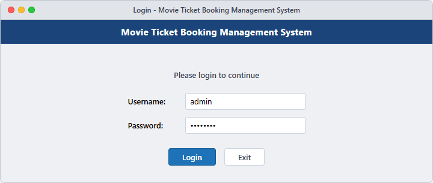
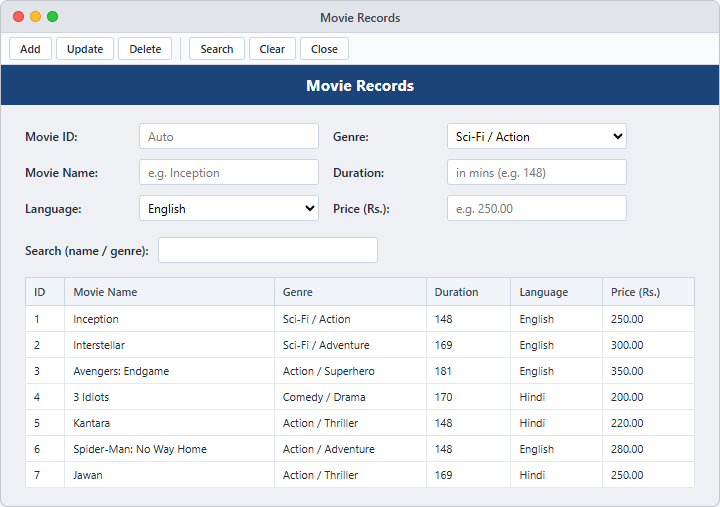
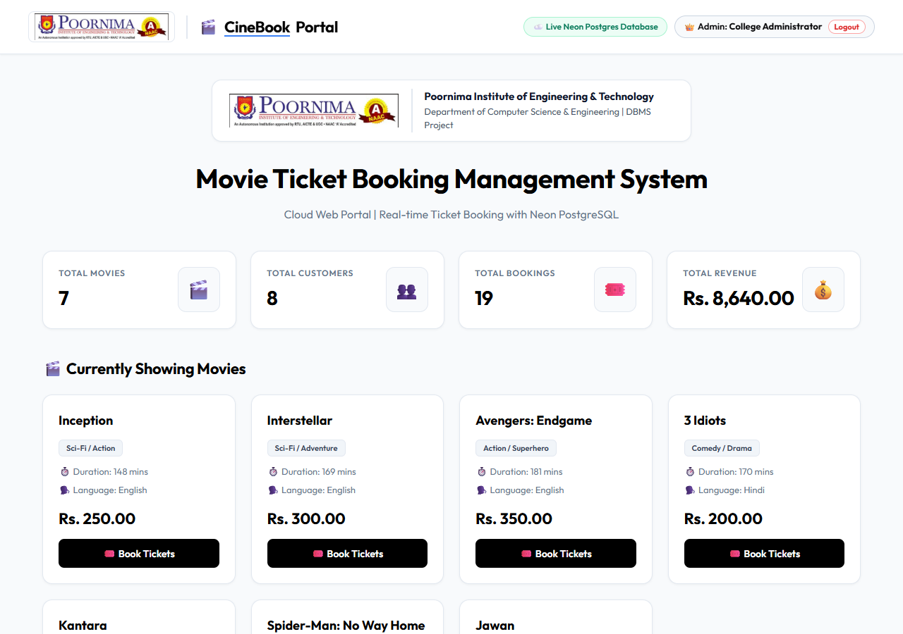

<p align="center">
  
</p>

# 🎬 Movie Ticket Booking System

A desktop and web-based movie ticket booking application developed as part of the 3rd Semester B.Tech curriculum. The project includes a Java Swing desktop application for cinema counter operators and a deployed web portal connected to a cloud database.

---

### 📌 Project & Student Details

- **Student Name:** Mahika Khanna
- **Registration No:** PIET25CS089
- **Course:** B.Tech — Computer Science & Engineering
- **Year & Semester:** 2nd Year / 3rd Semester
- **Project Guide:** Dr. Shikha Gautam (Assistant Professor, Dept. of CSE)
- **College:** Poornima Institute of Engineering & Technology (PIET), Jaipur

---

### 🔗 Quick Links

- 🌐 **Live Website:** [movie-ticket-booking-alpha-eight.vercel.app](https://movie-ticket-booking-alpha-eight.vercel.app)
- 🔐 **Admin Login:** [movie-ticket-booking-alpha-eight.vercel.app/login](https://movie-ticket-booking-alpha-eight.vercel.app/login) *(Username: `admin`, Password: `admin123`)*
- 📄 **Project Report (DOCX):** [Download Word File (.docx)](https://movie-ticket-booking-alpha-eight.vercel.app/api/download?type=docx)
- 📑 **Project Report (PDF):** [Download PDF File (.pdf)](https://movie-ticket-booking-alpha-eight.vercel.app/api/download?type=pdf)

---

### 🛠️ Tech Stack

- **Desktop Interface:** Java (JDK 17), Java Swing, JDBC
- **Web Interface:** HTML5, CSS3, JavaScript (ES6)
- **Database:** MySQL (Local) / PostgreSQL (Neon Cloud)
- **Deployment:** Vercel Serverless Functions

---

### ⚡ Key Features

1. **User Authentication:** Login system for admin and counter operators.
2. **Dashboard:** Quick summary showing total movies, customers, bookings, and revenue.
3. **Movie Management:** Add new movies, update details (genre, duration, ticket price), search, and delete records.
4. **Customer Records:** Register customer contact details (name, phone, email).
5. **Ticket Booking:** Select movie, enter seat details, calculate total price automatically, and confirm booking.
6. **Cancellation:** Cancel confirmed bookings with automatic status updates.

---

### 📸 Screenshots

#### 1. Java Swing Desktop App
| Login Screen | Dashboard Overview |
| :---: | :---: |
|  |  |

| Movies Management | Ticket Booking |
| :---: | :---: |
|  |  |

#### 2. Cloud Web Portal
| Online Movies & Booking | Live Booking History |
| :---: | :---: |
|  |  |

---

### 🚀 How to Run Locally

1. **Clone the repository:**
   ```bash
   git clone https://github.com/parasarora2008x-arch/mahika-khanna-movie-ticket-booking.git
   cd mahika-khanna-movie-ticket-booking
   ```

2. **Set up the Database:**
   - Open MySQL and import the tables from `database.sql`:
     ```sql
     SOURCE database.sql;
     ```
   - Configure your MySQL username and password in `db.properties`.

3. **Run the Java Application:**
   - Double-click `run.bat` or run:
     ```bash
     mvn compile exec:java
     ```

4. **Run the Local Web Server (Optional):**
   - Double-click `start_website.bat` and open `http://localhost:8080` in your browser.

---

### 📂 Project Structure

```
├── src/main/java/          # Java source code (Swing UI, DAOs, Database connection)
├── public/                 # Web portal files (index.html, login.html, logo)
├── api/                    # Vercel serverless functions for backend APIs
├── snapshots/              # Screenshots of the application and college banner
├── database.sql            # MySQL schema and sample seed data
├── PROJECT_REPORT_SRS.docx # Complete college project report (.docx)
├── PROJECT_REPORT_SRS.pdf  # Complete college project report (.pdf)
├── run.bat                 # One-click launcher for Java app
└── README.md               # Project documentation
```
